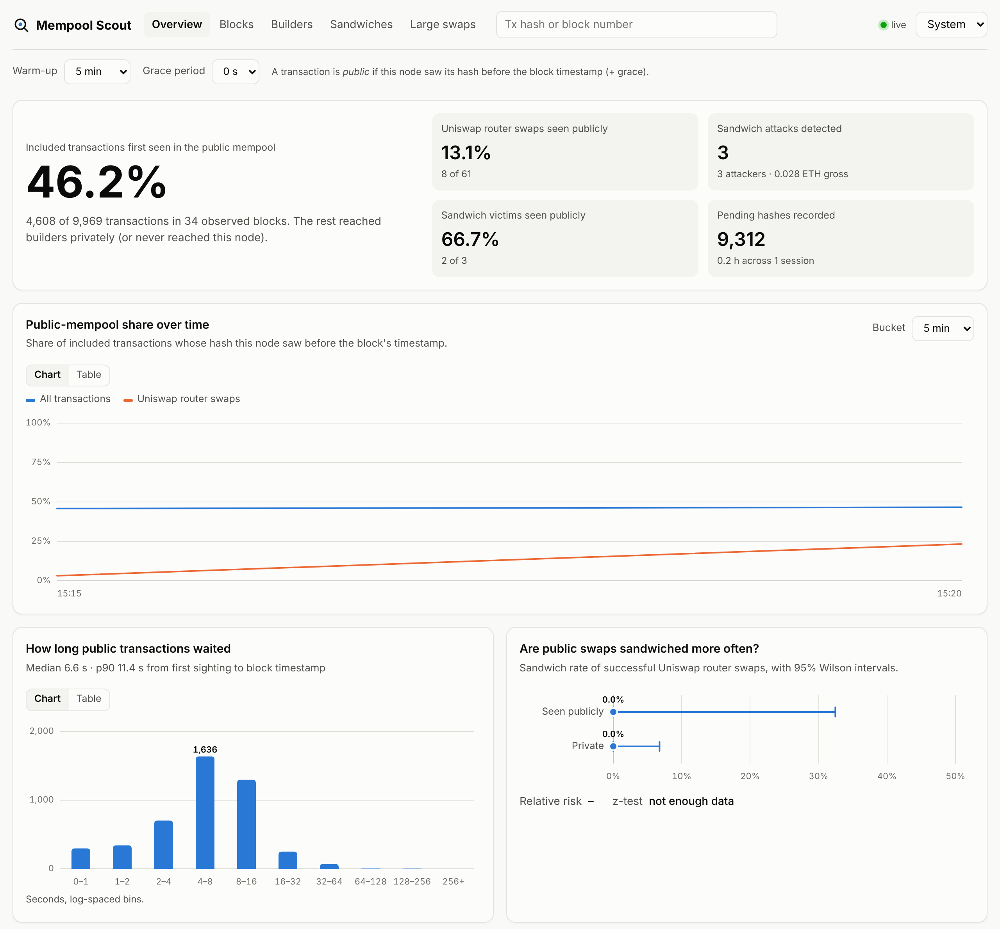
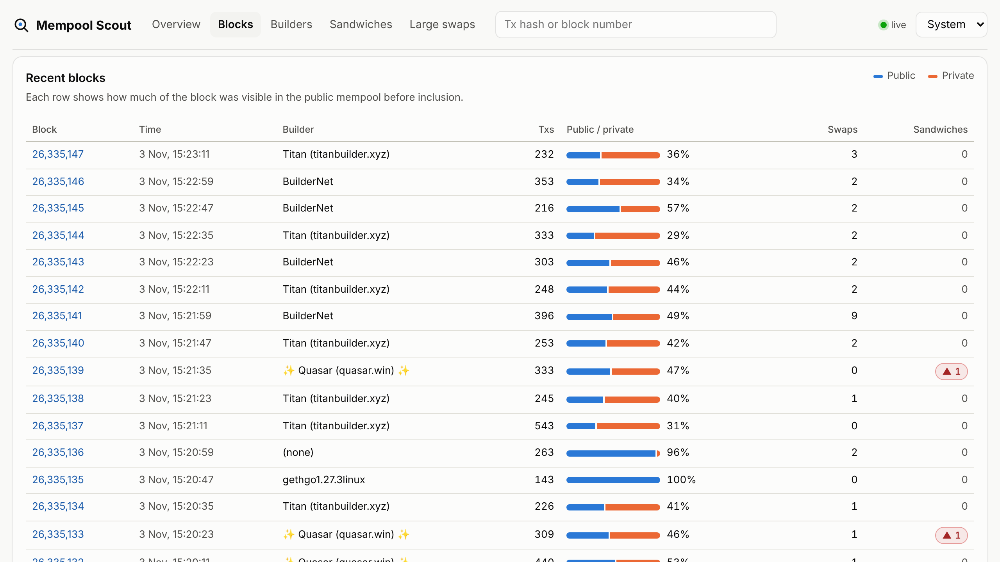
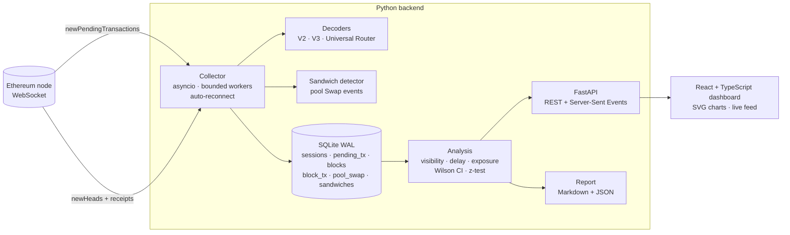

# Ethereum Mempool Scout

**A measurement system for Ethereum transaction privacy and MEV.**
Mempool Scout records when transactions appear in the public mempool, matches them
against the blocks that include them, detects sandwich attacks from on-chain swap
events, and serves the results through a REST API and a web dashboard.

[](https://github.com/CryptographyBloke/Ethereum-Mempool-Scout/actions/workflows/ci.yml)
· Python 3.10+ · React + TypeScript · FastAPI · SQLite · MIT

[中文说明](README.zh-CN.md) · [Methodology](docs/methodology.md)



<details><summary>Blocks view</summary>



</details>

---

## Research questions

Since the move to proposer–builder separation, a growing share of Ethereum order
flow bypasses the public mempool and goes straight to block builders. This project
measures that shift and its security consequences:

| | Question | Output |
|---|---|---|
| **RQ1** | What share of included transactions was visible in the public mempool before inclusion? How does it vary by transaction type and builder? | public share, inclusion-delay distribution, per-builder table |
| **RQ2** | Are publicly visible Uniswap swaps sandwiched more often than private ones? | sandwich rate per group with 95% Wilson CIs, relative risk, two-proportion z-test |
| **RQ3** | How concentrated is block building, and which builders rely on private flow? | block share and public share per builder |

Definitions, statistics, threats to validity and related work are in
[docs/methodology.md](docs/methodology.md).

## Pilot run

A 12-minute pilot against a free public endpoint (`ethereum-rpc.publicnode.com`,
3 Nov 2026) checked the whole pipeline on mainnet:

| Metric (5-min warm-up, 0 s grace) | Value |
|---|---|
| Collection window | 3 Nov 2026, 15:11–15:23 UTC (1 session, 1 vantage point) |
| Pending hashes recorded | 9,312 |
| Eligible blocks / included transactions | 34 / 9,969 |
| Included transactions seen publicly first | 46.2% |
| Uniswap router swaps seen publicly first | 13.1% (8 of 61) |
| Inclusion delay of public transactions | median 6.6 s, p90 11.4 s |
| Blocks with a plain client tag (geth) or no tag, 4 blocks | 95–100% public |
| Blocks from the largest builders (Titan, Quasar, BuilderNet), 29 blocks | 39–48% public |
| Sandwiches detected (all 60 blocks) | 5 |

These numbers only show that the system works: one vantage point and a few minutes
of data are not enough for conclusions. Comparable results need days of collection
from several vantage points (see the roadmap below).

## Architecture



| Component | File | Notes |
|---|---|---|
| WebSocket JSON-RPC client | `mempool_scout/rpc.py` | Small custom client: exact subscription params, 256 MiB frames, per-subscription queues |
| Collector | `mempool_scout/collector.py` | Timestamps every pending hash immediately; bounded fetch queue; retries when nodes lag behind a load balancer; re-org-safe block replacement |
| Swap decoders | `mempool_scout/decoders.py` | 11 V2 functions, 8 V3 functions, `multicall`, Universal Router commands; measures size on the WETH side |
| Sandwich detector | `mempool_scout/sandwich.py` | Works on executed V2/V3 `Swap` logs, so it also covers bots that call pools through their own contracts |
| Storage | `mempool_scout/storage.py` | SQLite in WAL mode: one writer (collector), many readers (API, report) |
| Analysis | `mempool_scout/analysis.py` | One SQL layer shared by the dashboard and the report |
| API | `mempool_scout/api.py` | 14 endpoints + `/api/stream` SSE; OpenAPI docs at `/docs` |
| Dashboard | `frontend/` | React 18 + TypeScript + Vite; light/dark themes; every chart has a table view |

## Quick start

### 1. Get a WebSocket endpoint

Any Ethereum mainnet node with `eth_subscribe` and `eth_getBlockReceipts`:
Alchemy, Infura, QuickNode, Chainstack, or your own geth/reth/erigon node
(`ws://127.0.0.1:8546`). A self-hosted node with many peers gives the most
complete mempool view.

### 2. Run with Docker

```bash
export SCOUT_WSS_URL="wss://eth-mainnet.g.alchemy.com/v2/<YOUR_KEY>"
docker compose up --build
```

Open http://localhost:8000. The collector and the API run as separate containers
sharing one SQLite volume.

### 3. Or run locally

```bash
pip install -e ".[dev]"
export SCOUT_WSS_URL="wss://..."

mempool-scout collect --db data/scout.sqlite --vantage home-node   # terminal 1
mempool-scout serve   --db data/scout.sqlite                       # terminal 2

cd frontend && npm install && npm run dev                          # terminal 3 → http://localhost:5173
```

Run `npm run build` in `frontend/` once and `mempool-scout serve` will also serve the
built dashboard at http://127.0.0.1:8000.

### 4. Produce a report

```bash
mempool-scout report --db data/scout.sqlite --out reports --warmup-min 5 --grace-ms 0
```

This writes `reports/report.md` (tables for RQ1–RQ3) and `reports/report.json`
(all numbers, for notebooks and plots).

## Command reference

| Command | Purpose | Main options |
|---|---|---|
| `mempool-scout collect` | Stream mempool + blocks into SQLite | `--wss`, `--db`, `--vantage`, `--fetch-mode {full,hash}`, `--full-pending-objects`, `--workers`, `--large-swap-eth`, `--router ADDR=LABEL`, `--no-receipts` |
| `mempool-scout serve` | REST API + dashboard | `--db`, `--host`, `--port` |
| `mempool-scout report` | Markdown + JSON report | `--db`, `--out`, `--warmup-min`, `--grace-ms` |

`--fetch-mode hash` only timestamps hashes. That is enough for RQ1 and uses about
1% of the RPC calls, so it suits free-tier endpoints.

## API

| Endpoint | Returns |
|---|---|
| `GET /api/overview` | headline metrics (RQ1–RQ3) |
| `GET /api/visibility/timeseries?bucket_s=3600` | public share per time bucket |
| `GET /api/visibility/types` · `/api/visibility/delay` | by transaction type · inclusion-delay histogram |
| `GET /api/exposure` | RQ2 rates, CIs, z-test |
| `GET /api/builders` | per-builder statistics |
| `GET /api/blocks` · `/api/blocks/{n}` | recent blocks · one block with per-tx visibility and sandwich roles |
| `GET /api/sandwiches` · `/api/swaps/large` | detected sandwiches · large pending swaps |
| `GET /api/tx/{hash}` | everything known about one transaction |
| `GET /api/stream` | Server-Sent Events: `block` and `alert` |

All analytical endpoints accept `warmup_min` and `grace_ms`, so the definitions
can be changed for sensitivity analysis. Interactive docs are at `/docs`.

## Data model

| Table | One row per | Key columns |
|---|---|---|
| `sessions` | collector connection | `started_ms`, `heartbeat_ms`, `vantage`, `endpoint_host` |
| `pending_tx` | hash seen in the mempool | `first_seen_ms`, fees, `is_deploy` |
| `swap_intent` | decoded swap (mempool or block) | `function`, `token_in/out`, amounts, `eth_notional` |
| `blocks` | block | `timestamp`, `builder_tag`, `fee_recipient`, `base_fee` |
| `block_tx` | included transaction | `tx_index`, `status`, `priority_fee_gwei`, `is_router_swap` |
| `pool_swap` | Uniswap V2/V3 `Swap` event | `pool`, `amount0`, `amount1` (signed, pool view) |
| `sandwiches` | (victim, pool) | `front_hash`, `back_hash`, `attacker`, `gross_profit_eth` |

## Tests

```bash
pytest -q                       # 21 tests: decoders, sandwich heuristic, statistics, end-to-end pipeline, API
cd frontend && npm run build    # type-check + production build
```

The end-to-end test runs the real collector against a simulated node: block,
receipts, a sandwich and mempool sightings go through the database, analysis,
report and every API endpoint.

## Roadmap

- [ ] Multi-vantage collection and per-vantage comparison (self-hosted node vs hosted RPCs)
- [ ] Uniswap V4, Curve, Balancer and aggregator decoding
- [ ] Validate sandwich labels against a public MEV dataset; measure precision/recall
- [ ] Net profit: subtract gas and coinbase transfers
- [ ] Slippage-tolerance analysis: does a looser `amountOutMin` predict being sandwiched?
- [ ] Export to Parquet and analysis notebooks with publication-quality figures
- [ ] Write-up of a multi-week measurement

## Ethics

Read-only. The tool never signs or sends transactions and only processes data the
Ethereum network makes public. See [methodology](docs/methodology.md#ethics).

## Citation

If you use this software, please cite it via [CITATION.cff](CITATION.cff).

## License

MIT
